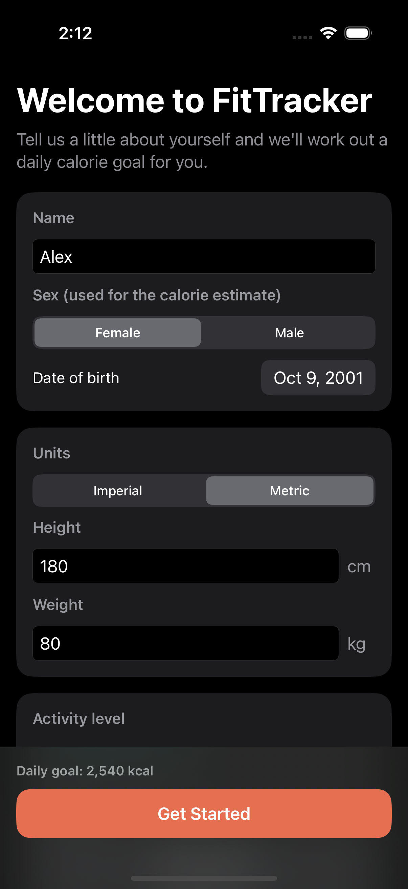
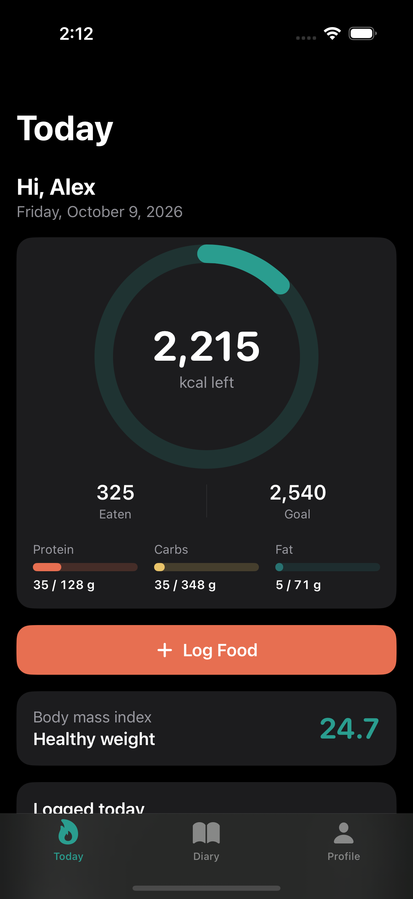
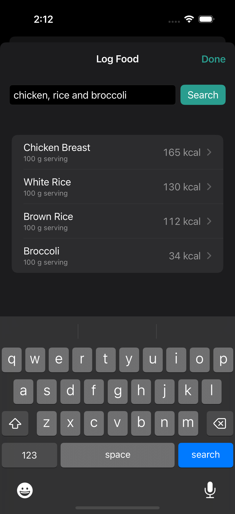
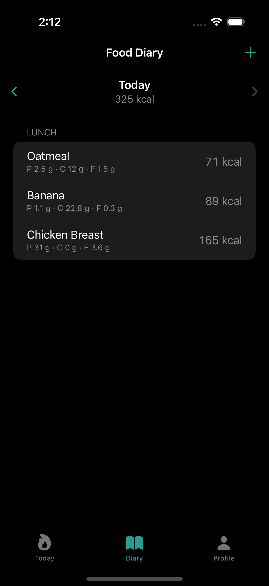

# FitTracker

A SwiftUI calorie and macro tracker for iPhone. Tell it your height, weight, and goal; it works out a daily calorie target, and you log what you eat against it.

> **Derived from [cjbriseno/FitTracker](https://github.com/cjbriseno/FitTracker).** The original app was a 2023 CSU Fullerton class project by Cristopher Briseno, Oscar Hernandez, and Bryan Medina, hosted in Cristopher's repository. This repository keeps that project's full commit history and builds on it. See [Credits](#credits).

This version is a ground-up rework of the original, built around one idea: every behaviour the app promises should be checked by an automated test, and running those tests should take one command.

| Onboarding | Today | Search | Diary |
|---|---|---|---|
|  |  |  |  |

## What it does

- **Personal calorie goal.** Onboarding collects height, weight, age, sex, activity level, and weight goal in metric or imperial units. The goal comes from the Mifflin-St Jeor equation, scaled by activity and adjusted for losing, maintaining, or gaining.
- **Plain-English food search.** Type "2 eggs and toast" and get one result per food, using the [CalorieNinjas](https://calorieninjas.com) API. With no API key the app falls back to a bundled list of common foods, so it runs straight after cloning.
- **Daily dashboard.** A ring shows calories left, with protein, carbohydrate, and fat progress and your BMI underneath.
- **Food diary.** Entries are grouped by meal and by day. Swipe to delete. Everything is stored on the device and survives relaunch.
- **Editable profile.** Change your details and the targets update immediately, or reset all data.

## Quality engineering

| Layer | Tooling | Count | What it covers |
|---|---|---:|---|
| Unit | Swift Testing | 94 tests (186 runs with parameters) | Calculations, validation boundaries, JSON decoding, networking, persistence, search state |
| UI | XCUITest | 24 tests | Onboarding, logging, deleting, persistence across relaunch, error and empty states |
| Automation | Python `unittest` | 97 tests | The test runner itself: simulator choice, result parsing, reports, exit codes |

Line coverage of the app target is 99% with both Swift suites, and CI fails below 85%.

Design choices that make the app testable:

- **No hidden dependencies.** The clock, calendar, storage, and network are passed in. Unit tests use a fixed UTC calendar, in-memory storage, and a `URLProtocol` stub, so they never touch the network, the real clock, or `UserDefaults`.
- **Deterministic UI tests.** Launch arguments put the app in a test mode with isolated storage, the offline food list, and animations off. A launch environment variable can force every search to fail, so error handling is tested without relying on a flaky network.
- **Page objects.** UI tests read as user actions (`dashboard.logFood("banana")`); element lookup lives in `FitTrackerUITests/Screens`.
- **One source of truth for identifiers.** `Shared/UITestSupport.swift` is compiled into both the app and the UI test target, so an accessibility identifier cannot drift between them.
- **Boundary-value tests.** Validation limits, BMI category cut-offs, midnight day rollover, and age-on-birthday are each tested on both sides of the boundary.
- **Regression tests for the original bugs.** See the list below; each fix has a test that fails without it.

### Bugs found and fixed from the 2023 version

| Problem | Fix |
|---|---|
| API key hard-coded in source and pushed to a public repo | Key is read from a git-ignored `Config/Secrets.xcconfig` |
| Sign In button did nothing; password field showed plain text and was printed to the console | Removed the fake login. The app has no server, so onboarding now collects a profile instead |
| Dashboard showed 0 calories after relaunch until the diary was opened | One observable `DiaryStore` feeds every screen |
| Diary rows were identified by food name, so logging the same food twice broke deletion | Each entry has its own UUID |
| `sodium_mg` and similar fields were typed `Int`, so any fractional API value failed the whole search | All nutrients decode as `Double`; optional fields tolerate missing or odd values |
| Network errors were silently dropped; the URL was force-unwrapped | Typed errors with user-facing messages and a retry button |
| Calorie goal fixed at 3000 and protein at a placeholder 75 / 200 g | Targets are calculated from the profile |
| Nested `NavigationView`s produced stacked navigation bars | Single `NavigationStack` per tab |
| A slow response to an old search could overwrite newer results | Superseded responses are discarded |
| Number pads had no way to dismiss and could cover the next field | Keyboard toolbar with a Done button |
| Committed tests did not compile and called the live API | Replaced by the suites above |

## Running it

Requirements: Xcode 16 or later and an iOS 17+ simulator. Python 3.9+ for the automation (the standard library is enough).

```bash
git clone https://github.com/iambryyy/FitTracker.git
cd FitTracker
open FitTracker.xcodeproj   # then press Run
```

Optional, for live food search: copy `Config/Secrets.example.xcconfig` to `Config/Secrets.xcconfig` and put a free [CalorieNinjas key](https://calorieninjas.com/api) in it.

## Running the tests

```bash
# Everything, on the newest installed iPhone simulator, with a coverage gate
python3 automation/qa.py run --suite all --min-coverage 85

# Just the fast unit tests
python3 automation/qa.py run --suite unit

# Choose a device, and retry a failing test once
python3 automation/qa.py run --suite ui --device "iPhone 16 Pro" --os 18 --retries 1

# Re-report on an existing result bundle
python3 automation/qa.py report path/to/TestResults.xcresult

# See which simulator would be used
python3 automation/qa.py simulators

# Test the automation itself
cd automation && python3 -m unittest discover -s tests -t .
```

`qa.py run` picks a simulator, runs `xcodebuild`, reads the result bundle with `xcresulttool` and `xccov`, prints a Markdown summary, and writes `report.md`, `junit.xml`, and the full `xcodebuild.log` to `automation/reports/<timestamp>/`.

| Exit code | Meaning |
|---:|---|
| 0 | All tests passed and coverage met the minimum |
| 1 | At least one test failed, or no tests ran |
| 2 | Tests passed but coverage is below `--min-coverage` |
| 3 | The run could not complete (build error, no matching simulator, missing tools) |

A run in which zero tests execute is reported as a failure, not a pass.

The tests also run from Xcode with Cmd-U. `.github/workflows/ci.yml` runs the same commands on GitHub Actions.

## Project layout

```
FitTracker/
  App/         Composition root, launch configuration, root view
  Models/      FoodItem, DiaryEntry, UserProfile
  Logic/       NutritionCalculator, UnitConversion, ProfileDraft (validation)
  Services/    NutritionService protocol, CalorieNinjas client, offline service, storage
  Stores/      DiaryStore, ProfileStore, FoodSearchModel
  Views/       Onboarding, Dashboard, Search, Diary, Profile
  Resources/   SampleFoods.json (offline food list)
Shared/              Launch flags and accessibility IDs used by app and UI tests
FitTrackerTests/     Unit tests (Swift Testing)
FitTrackerUITests/   UI tests (XCUITest) and page objects
automation/          Python test runner and its tests
Config/              Build configuration and the secrets template
```

## Known limitations

- iPhone only, portrait only.
- The calorie and macro targets are estimates from standard formulas, not medical advice.
- The offline food list has 34 foods, all per 100 g, and ignores quantities in the query.
- Data stays on the device; there are no accounts and no sync.

## Credits

This project is derived from [cjbriseno/FitTracker](https://github.com/cjbriseno/FitTracker), the original team repository owned by Cristopher Briseno. The idea, the colour palette, the dashboard ring, and the CalorieNinjas-backed food search all come from that project, and its commits are preserved in this repository's history.

Original 2023 team:

- **Cristopher Briseno** ([@cjbriseno](https://github.com/cjbriseno)): project owner, login screen, and dashboard
- **Oscar Hernandez**: persistent local storage
- **Bryan Medina**: food search via API and the food diary

What this repository adds, by Bryan Medina: the testable architecture, profile-based calorie and macro targets, the per-day diary, the unit and UI test suites, the Python test automation, and CI.
